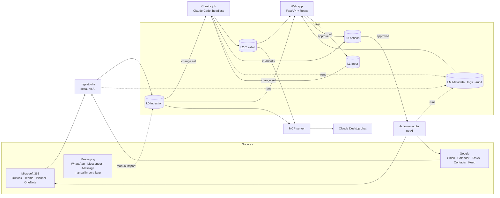

# Second Brain — Architecture & Requirements

> Status: draft v0.1 · 2026-11-05 · Owner: Adam
> Scope: personal productivity system over work (Microsoft) and personal (Google) data, running locally.

---

## 1. Goals

- Single place to see what needs doing across **all** accounts (work + personal, n accounts each).
- Fast, AI-free lookup of facts about my life (people, places, tools, preferences).
- Chat with all data through Claude.
- AI-generated insights (birthdays, unanswered emails, conflicts) without burning seat tokens.
- Eventually: propose and execute write-back actions (drafts, tasks) with human approval.

## 2. Design principles

| # | Principle |
|---|-----------|
| P1 | Conventional code for ingest and UI; AI only where interpretation is needed (curation, insights, drafting). |
| P2 | The vault is the single source of truth for every interface (web app, MCP connector, curator). |
| P3 | Multi-account by design — no hard-coded single mailbox/calendar. |
| P4 | Incremental everywhere: delta ingest, change-set curation, AI never re-reads the whole vault. |
| P5 | Human in the loop for any write to external systems. |
| P6 | Everything observable: every job run and action is logged and visible on the audit page. |
| P7 | Independent of the DataBrothers stack; keeps working if I leave DBI. |

## 3. Data layers

| Layer | Content | Written by | Storage | Prefix |
|-------|---------|------------|---------|--------|
| **L0 – Ingestion** | Items from external systems: mail, calendar events, tasks, contacts, notes, chats | Ingest jobs (no AI) | SQLite | `l0_` |
| **L1 – Input** | My own input: text, voice notes, documents, corrections, stray ideas | Web app (input queue) | SQLite + attachment files | `l1_` |
| **L2 – Curated** | Knowledge files (people, places, topics), entities, links (entity ↔ item / entity), insights | Curator jobs (AI over L0 + L1) | Markdown git repo + SQLite | `l2_` |
| **L3 – Actions** | Proposed and approved write-backs to external systems | Curator proposes, I approve, executor runs | SQLite | `l3_` |
| **LM – Metadata, logs, audit** | Accounts, sync cursors, job runs, executed actions | All jobs | SQLite | `lm_` |

Flow: **L0 + L1 → L2 → L3**; LM records every step.
L0 keeps all kinds in one `l0_items` table (common columns + JSON for kind-specific fields), so a new data type needs no schema change.



## 4. L0 sources

### 4.1 Work — Microsoft stack (DataBrothers)

| Source | API | Tier | Notes |
|--------|-----|------|-------|
| Outlook mail | Microsoft Graph | Easy | Delta query |
| Outlook calendar(s) | Microsoft Graph | Easy | Multiple calendars supported |
| Teams chats | Microsoft Graph | Easy | Permissions/consent to verify |
| Planner | Microsoft Graph | Easy | |
| OneNote | Microsoft Graph | Easy | Used for personal unstructured notes |
| Org data warehouse | — | Out of scope | Possible later for org-structure context |

### 4.2 Personal — Google stack

| Source | API | Tier | Notes |
|--------|-----|------|-------|
| Gmail | Gmail API | Easy | History API for deltas |
| Google Calendar(s) | Calendar API | Easy | Sync tokens |
| Google Tasks | Tasks API | Easy | |
| Google Contacts | People API | Easy | Phone contacts source |
| Google Keep | No official API for personal accounts | Deferred | Later via Takeout import (unofficial lib rejected: needs account master token) |
| Google Drive | Drive API | Deferred | Not yet |

**Decision (v1 Google scope):** Gmail (full history), Calendar, Tasks, Contacts.

### 4.3 Messaging

| Source | Tier | Approach |
|--------|------|----------|
| WhatsApp | Hard | Manual chat export → import (later) |
| Facebook Messenger | Hard | Manual export → import (later) |
| iMessage | Hard | Local DB readable on Mac only; later |

**Decision:** start with the easy tier; messaging is a later, manual import.

## 5. Jobs

### 5.1 Ingest jobs → L0 (no AI)

- One job per source type, parameterised by account (multi-account).
- Incremental via delta queries / sync tokens; store cursor per account + source.
- **Full-load sources:** pull full set → row hash compare → emit inserts/updates/deletes. Curator only sees the change set.
- Change set: every L0 row records the ingest run that last changed it (`changed_run_id`); the curator reads rows changed since its last run.
- Cadence: **every 5–15 min**. Zero token cost.
- Optional: on-demand refresh (dashboard button) re-runs ingest for a scope, then UI re-reads the vault. UI never fetches directly from source APIs.

### 5.2 Curator jobs → L2, L3 (AI)

- Runtime: **Claude Code, headless**, started by Windows Task Scheduler, runs on the Claude Team seat (no API/extra usage).
- Inputs: new L1 input items + L0 change set since last run.
- **Early exit** if nothing changed → no Claude call.
- Responsibilities:
  - Turn input data into / update knowledge markdown files.
  - Entity resolution (see §7).
  - Generate insights (birthdays, unanswered mail, conflicts, today/week overview).
  - Propose actions (see §6).
- Cadence (proposal):
  - **Hourly** — input queue + incremental changes.
  - **Daily morning** — insight pass for the day/week.
- Constraint: runs only while the PC is awake; backlog shown as pending on the audit page.

#### Curator v1 (decided 2026-11-06)

| Topic | Decision |
|-------|----------|
| Knowledge files | `%LOCALAPPDATA%\ap-bubble\knowledge\` (`people/`, `places/`, `topics/`, `me/`); no git yet. Markdown is the source of truth; L2 SQLite tables come with search. |
| What is curated | Everything: queued L1 inputs and the L0 change set. |
| Backlog | Only items from the last 30 days, then new changes; older 2026 items via a later backfill. |
| Noise (skipped before AI) | Teams system messages; promotions and newsletters (Gmail Promotions / Social / Updates / Forums, `List-Unsubscribe`, Outlook "Other"); deleted items; containers (calendars, lists, chats, folders). |
| Grouping | Teams messages per chat and day; mail per conversation; one unit per event, task, contact, input. |
| Run | Python job `ap-bubble-curator run`: early exit when nothing to do; otherwise packs units into size-limited batches, writes each as a file, runs `claude -p` in the knowledge folder (tools: Read, Write, Edit, Glob, Grep; edits auto-accepted), logs the run in `lm_job_runs`. `--dry-run` only writes the batch files. |
| L1 status | `queued` → `processing` while curated → `done` or `failed` (with error). |
| L0 progress | A cursor over `(changed_run_id, item id)`, advanced only when all of a run's batches succeed; rows of ingest runs still running are left for later. |
| Files of inputs | Text, PDF, images read by Claude directly; voice notes need transcription (later). |
| Cadence | Started by hand for now; scheduled later together with ingest. |

## 6. L3 Actions (write-back) — future

- AI produces a **proposed action** record (type, target system, account, payload), e.g.:
  - Create email draft (AI-composed body).
  - Create task in Planner (work) or Google Tasks (personal).
- Proposals land in an **action queue**; can be triggered proactively from insights ("draft reply to this unanswered email").
- **Executor** is deterministic code (plain HTTP call to Graph/Google), runs only after approval on the dashboard.
- Every executed action logged in LM → audit page.
- Open: routing rules work vs. personal account.

## 7. Entity resolution (L2)

- Same real entity appears differently across sources (e.g. knowledge file "Petr Novák", Gmail address, calendar "Petr, coffee").
- Curator links records to one entity:
  1. **Auto-link** on certain matches (exact email, phone).
  2. **Ask me** when ambiguous → question appears on the dashboard as a pending item.
  3. **Correct** via L1 input when wrong → fixed on next curator run.

## 8. Interfaces

### 8.1 Web app — FastAPI + React (no AI inside)

| Page | Content |
|------|---------|
| **Dashboard** | Combined view of selected calendars (e.g. DBI work + personal) for availability; all tasks (Planner + Google Tasks); work / personal / both filters; curated insights (day / week / hour); pending questions and proposed actions; warning banner when ingest/curator failed or data is stale. |
| **Search & entity view** | Keyword search over structured, semi-structured and unstructured data; entity page (e.g. person → birthday, recent mail, next meeting). |
| **Input** | Upload text, voice, documents, corrections, quick-capture ideas → L1. |
| **Audit** | From LM: history of ingest, curator and action runs; status, duration, errors, items processed; data freshness per source/account. |

Dashboard sections (added 2026-11-06):
- **Insights & reminders** — each item can be replied to with free text; the reply is stored as a new L1 input (linked to the insight) for the curator.
- **Questions** — curator-generated questions about my data: missing information, unclear or conflicting facts, ambiguous entities (§7). Answering creates a new L1 input; answered/dismissed questions leave the list.

### 8.2 Chat — MCP connector

- Local Python **MCP server** registered in Claude Desktop.
- Tools (initial): `search_vault`, `get_entity`, `get_calendar(range, accounts)`, `list_tasks(filters)`, `get_insights`.
- Shares query layer with the FastAPI backend → chat and web app see identical data.

## 9. Hosting & tech stack (v1: local-only)

| Component | Technology |
|-----------|------------|
| Host | Local Windows PC, desktop-only access (no mobile for now) |
| Ingest jobs | Python, Windows Task Scheduler |
| Vault: L0, L1, L2 entities and insights, L3, LM | SQLite |
| L2 knowledge files | Markdown files in `%LOCALAPPDATA%\ap-bubble\knowledge\` (one file per person / place / topic); git later |
| Curator | Claude Code headless, Windows Task Scheduler |
| Web app | FastAPI backend + React frontend, local service |
| Chat connector | Python MCP server → Claude Desktop |
| Search | Keyword search (v1) |

**Repository:** `ap-bubble` (code). Knowledge files live with the runtime data, outside the repo; versioning them in git comes later.

**Future:** cloud hosting with usage-based AI (previously considered Cloudflare); split is ready for it since ingest, vault and web app need no AI.

## 10. Proposed vault layout

```
%LOCALAPPDATA%\ap-bubble\
├── vault.db                     # SQLite: l0_, l1_, l2_, l3_, lm_ tables
├── inbox/                       # L1 attachments (voice, docs)
├── knowledge/                   # L2 markdown (git later)
│   ├── people/
│   │   └── petr-novak.md
│   ├── places/
│   ├── topics/
│   └── me/                      # profile, household, tools I use
├── curator/runs/<run id>/       # batch files given to Claude, and its output
└── logs/
```

## 11. Deferred / out of scope (v1)

| Item | Status |
|------|--------|
| Security hardening (disk encryption, OAuth token storage, work data on personal machine / ISO 27001 scope) | Deferred |
| Remote backup of knowledge repo / SQLite | Skipped for now |
| Embedding-based semantic search | Maybe later; keyword first |
| Mobile access (e.g. Tailscale) | Not needed now |
| Messaging app ingestion | Later, manual import |
| Org DWH ingestion | Later |
| Cloud hosting | Later |

## 12. Open questions

1. Exact cadences for ingest and curator (token budget vs. freshness).
2. Push notifications / webhooks vs. polling for near-real-time ingest.
3. Action routing rules (work vs. personal) and approval UX.
4. Initial bulk input format for bootstrapping the knowledge base (voice + documents).
5. ~~Keep ingestion approach for a personal Google account.~~ Deferred; Takeout import later.
6. Schema of curated SQLite tables (entities, links, insights, actions).